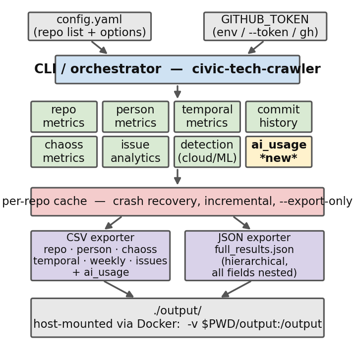

# civic-tech-crawler: A Lightweight CHAOSS-Aligned Repository Mining Tool with AI-Usage Detection for Civic-Technology Research

**Authors** (single-anonymous, listed on manuscript):
1. Janne Parkkila — LUT University, Lappeenranta, Finland — `Janne.Parkkila@lut.fi` — ORCID *TBD*
2. Viktoriia Olshanskaia — LUT University — `viktoriia.olshanskaia@lut.fi` — ORCID *TBD*
3. Duc Thinh Tran — IMT Atlantique, Brest, France / LUT University — `Duc-Thinh.Tran@imt-atlantique.fr` — ORCID *TBD*
4. Antti Knutas — LUT University — `Antti.Knutas@lut.fi` — ORCID *TBD*

**Track:** MSR 2027 Data and Tool Showcase
**Format target:** IEEE conference, 10 pt, `\documentclass[10pt,conference]{IEEEtran}`, 4 pages main text + 1 page references
**Repository:** <https://github.com/Japskua/civic-tech-git-crawler> (MIT)
**Zenodo (companion dataset):** <https://doi.org/10.5281/zenodo.20497015> (CC-BY-4.0)
**Docker image:** `docker build -t civic-tech-crawler .` (host-side mounts for `/config` and `/output`)

---

## Abstract

Civic technology — open-source software built to support government services, civic engagement, deliberation, and public participation — is an under-studied subdomain of open source where existing repository-mining platforms are overkill for the typical empirical sample size. We present **civic-tech-crawler**, a lightweight Python command-line tool that collects 25+ CHAOSS and DORA metrics, per-contributor effort signals, and (new in the 2026 release) a dedicated **AI-usage layer** that separates AI-assisted development from shipped-LLM product features and separates active use from declared intent. The tool implements a measurement-coverage-bias fallback for GitHub's asynchronous stats endpoints, ships as a `pip`-installable package and a Docker image with explicit host mounts, is covered by 68 unit tests under continuous integration, and has produced a Zenodo-archived corpus of 55 civic-tech projects spanning 24 organisations and five continents. The dataset was the basis of a recent empirical analysis of the civic-tech landscape (Olshanskaia et al., GoodIT '26). This paper describes the tool itself: architecture, the design decisions that make the AI-usage layer and coverage-bias fallback possible, and tool-level validation evidence.

---

## 1. Introduction

Mining tooling for open-source research has matured for the large-ecosystem case. **GrimoireLab** [grimoirelab] integrates ~30 data sources through an Elasticsearch/Kibana stack and underpins the official CHAOSS dashboards; **Augur** [augur] runs as a long-lived PostgreSQL-backed service with a web UI; **Perceval** [perceval] is GrimoireLab's low-level retrieval library. These tools are mature and well-engineered, but each assumes infrastructure — a running ELK cluster, a database service, a web stack — that a researcher studying a 30–100-repository defined sample does not need and, critically, cannot version-control alongside their analysis scripts.

A second gap is more recent. The 2025–2026 wave of agentic developer tooling (Claude Code, GitHub Copilot, Devin, Jules, Cursor, Codex) leaves measurable traces in repositories — agent config files, commit co-author trailers, agent-authored PRs — yet mainstream mining tools do not surface these signals as a first-class metric family. For empirical software-engineering studies of how AI tooling is actually being adopted in open source, this is a missing primitive.

`civic-tech-crawler` addresses both gaps. It is a single-command Python CLI that collects 25+ CHAOSS and DORA metrics into structured CSV/JSON files, implements a measurement-coverage-bias fallback for GitHub's asynchronous `/stats/*` endpoints (which systematically time out for less-trafficked repositories, biasing any analysis), and in its current release adds an **AI-usage detection layer** that distinguishes AI-assisted development from shipped-LLM product features and distinguishes active use from declared intent. The tool was built for civic-technology research but its design choices generalise to any empirical study of small-team, mission-driven OSS where lightweight reproducibility matters.

The tool has been in continuous use since February 2026. It produced the 55-repository corpus analysed in Olshanskaia et al. [goodit26], a recent empirical paper on the civic-tech landscape. That paper reports the findings; this paper describes the tool, with an emphasis on the design decisions that are not visible from the published findings alone and on the AI-usage module that is new in the current release.

**Contributions.** (1) A lightweight, CHAOSS-aligned repository-mining CLI with Docker distribution and continuous integration. (2) A measurement-coverage-bias fallback architecture for GitHub's asynchronous stats endpoints. (3) A novel AI-usage detection module that separates dev-vs-product and active-use-vs-intent, exposing a vocabulary of 15 tools/providers across 7 evidence sources. (4) A Zenodo-archived 55-project civic-tech corpus produced by the tool, serving as a reusable empirical substrate.

---

## 2. Tool Architecture

`civic-tech-crawler` is a ~4,500-line Python 3.13 package organised into three layers (Fig. 1): a thin **CLI/orchestrator** that reads a YAML configuration; a set of **collectors** that each produce a typed dataclass over the GitHub REST and GraphQL APIs; and a pair of **exporters** that serialise the in-memory dataset to CSV (one row per repository, contributor, issue, PR, tag, weekly snapshot, etc.) and JSON (a single hierarchical document). Intermediate per-repository results are cached on disk immediately after each successful crawl so that long-running crawls survive crashes and can resume where they left off.



**Fig. 1.** Architecture: CLI → orchestrator → eight collectors (`repo_metrics`, `person_metrics`, `temporal_metrics`, `commit_history`, `chaoss_metrics`, `issue_analytics`, `detection`, **`ai_usage`**) → per-repo cache → CSV / JSON exporters. The `ai_usage` collector (highlighted) is the main new contribution of the current release; all other collectors existed in the version used to produce the companion GoodIT '26 dataset.

### 2.1 Collector modularity

Each metric family lives in its own module under `src/civic_tech_crawler/collectors/`. Collectors are pure functions over a shared GitHub client and a `Repository` object; they return typed dataclasses. Adding a new CHAOSS metric or a new signal family requires only a new collector plus an exporter column. This factoring is what allowed the AI-usage detector (§2.4) to be added in a release without touching any of the existing six collectors.

### 2.2 Measurement-coverage-bias fallback

GitHub's `/stats/contributors` and `/stats/commit_activity` endpoints are computed asynchronously; they return HTTP 202 ("computing") for repositories whose stats are not already in cache. In practice this cache is populated for repositories with recent external API traffic and remains empty for less-trafficked repositories indefinitely. Any analysis that pulls burstiness, weekly commit counts, or contributor-week timelines directly from these endpoints silently drops to the "returned" subset, which is correlated with project activity itself — a textbook selection bias.

Two architectural choices address this:

1. A **`commit_history` collector that runs before `chaoss_metrics`.** It parses the complete commit history via the lower-level `/repos/{o}/{r}/commits` endpoint, which does not depend on the async stats cache, and aggregates commits into ISO-week buckets with per-author breakdowns.

2. A **fallback path inside `chaoss_metrics`.** When `/stats/commit_activity` returns `None` after the configured retry budget, the collector consumes `commit_history`'s weekly snapshots instead. Burstiness, new-contributor rate, and weekly-activity timelines are therefore derivable for every repository in the sample, not only for the subset that GitHub's async cache happens to favour. On the 55-project corpus, the fallback raised burstiness coverage from the subset that `/stats/*` would have populated (34 of 55) to the full sample.

### 2.3 Bot detection

A regex-based detector (`is_bot_account`) filters contributors before any concentration metric is computed. It matches the `[bot]` suffix used by GitHub Apps and an explicit allowlist of common automation accounts (dependabot, renovate, github-actions, snyk-bot, mergify, sonarcloud, coveralls, etc.). Both bot-filtered and bot-included variants of HHI, elephant factor, and core/periphery counts are emitted so downstream analyses can inspect the bot effect rather than committing to one convention. The detector is covered by 39 unit tests spanning known-positive cases, legitimate humans whose logins contain "bot" or "robot", and case-sensitivity edge cases.

### 2.4 AI-usage detection

The AI-usage collector is the tool's main novel contribution and is to our knowledge the first first-class treatment of this signal family in a general-purpose repository-mining tool. It separates two orthogonal dimensions.

**Dev vs. product.** The `dev` group captures *using AI to build the software*: agent configuration files (`CLAUDE.md`, `AGENTS.md`, `.cursor/`, `devin/`), commit co-author trailers (`Co-Authored-By: Claude …`, `Co-Authored-By: Copilot …`), agent-authored commits and PRs (Copilot SWE agent, Devin, Jules bots), CI workflow references to AI actions, and AI review-bot comments. The `product` group captures *shipping LLM functionality to users*: declared dependencies on LLM provider SDKs (`openai`, `anthropic`, `cohere`, `deepseek`, `groq`) in root-level Python/JS manifests.

**Active use vs. declared intent.** Within `dev`, the detector distinguishes projects that merely *declare* AI intent (an agent config file with no AI-attributed contributions) from projects with *active use* (actual AI-coauthored commits and/or agent-opened PRs). This distinction matters methodologically: counting config files alone overestimates practised AI development.

**Vocabulary.** The current release recognises 15 tools/providers (10 dev, 5 product) across 7 evidence sources (`file`, `commit_trailer`, `commit_author`, `pr_author`, `pr_body`, `workflow`, `dependency`), with evidence-strength tiers (strong: file / commit_trailer / commit_author / pr_author; medium: workflow / pr_body / dependency; weak: topic). Each signal carries a first-appearance date so that adoption timelines are reconstructable.

**Outputs.** The collector produces three artefacts: `ai_usage.csv` (one row per repository, 15 columns), `ai_signals.csv` (one row per individual piece of evidence), and six aggregate files under `ai_usage_analysis/` (adoption summary, tool/provider frequency, source breakdown, adoption timeline, adopter-vs-non-adopter comparison). The full structured evidence list is also embedded in `full_results.json`.

### 2.5 Rate-limit, retry, and cache layers

A `RateLimiter` polls GitHub's rate-limit endpoint every 50 calls and sleeps until reset if the remaining budget drops below a configured buffer. A `retry_with_backoff` wrapper retries on transient statuses (403, 429, 500, 502, 503) with exponential backoff; a `retry_on_none` wrapper handles the async-stats 202-then-None pattern with a configurable attempt budget. Per-repository results are persisted to disk the moment they are collected, so a crawl surviving a network blip or an interrupt resumes from the next uncached repository on the next invocation. A `--force` flag re-crawls; `--export-only` rebuilds CSV/JSON from the cache without any API calls; `--skip-*` flags disable individual collectors for fast iteration.

---

## 3. Demonstration and Usage

### 3.1 Distribution

Two installation paths are documented and both are exercised by continuous integration:

```bash
# Path A — local Python (requires Python 3.13+ and uv)
uv sync
GITHUB_TOKEN=$(gh auth token) \
  uv run civic-tech-crawler --config config.yaml

# Path B — Docker (no local Python toolchain)
docker build -t civic-tech-crawler .
docker run --rm \
  -e GITHUB_TOKEN="$(gh auth token)" \
  -v "$PWD/config.yaml:/config/config.yaml:ro" \
  -v "$PWD/output:/output" \
  civic-tech-crawler
```

The Docker image exposes two mount points, `/config` and `/output`, so that the user's configuration stays on the host (read-only) and results persist on the host — never inside an anonymous Docker volume. Reviewers and replicators therefore do not need a working Python toolchain to reproduce a crawl.

### 3.2 Configuration

A run is described by a single YAML file. The minimal form:

```yaml
github:
  max_retries: 5
  retry_delay: 3
  rate_limit_buffer: 100

repositories:
  - "CodeForAfrica/PromiseTracker"
  - "codeforamerica/form-flow"
  - "mysociety/ceuk-marking"
  # ...

output:
  directory: "./output"
```

Bot-detection patterns, cloud/AI-ML detection keywords, and per-collector flags are all expressed in the same config file, so a study's analytic choices are fully version-controllable alongside its results.

### 3.3 Output

A single crawl writes a structured bundle of CSVs plus a hierarchical JSON document. Key files include `repo_metrics.csv` (one row per repository), `person_metrics.csv` (one row per repo-contributor pair with a bot flag), `chaoss_summary.csv` (bus factor, elephant factor, HHI with and without bots, core/periphery, network density), `temporal_summary.csv` (PR review turnaround, deployment frequency, lead time, change failure rate), `weekly_snapshots.csv`, `contributor_lifecycles.csv`, `issue_records.csv`, `pull_requests.csv`, `tags.csv`, `cross_project_overlap.csv`, and — new in the current release — `ai_usage.csv`, `ai_signals.csv`, plus the `ai_usage_analysis/` directory.

**Table I.** Excerpt from `ai_signals.csv` for `codeforjapan/BirdXplorer`, showing the per-signal evidence rows the detector emits. Mixed-tool, multi-source adoption (Claude Code + Devin + Roo across file, commit, PR, and workflow sources), with a datable first-appearance where the source permits — the structure a researcher needs to reconstruct per-project AI-adoption trajectories.

| Tool | Source | Evidence | Count | First seen |
|---|---|---|---:|---|
| claude_code | file | `CLAUDE.md` | 1 | 2025-04-28 |
| claude_code | file | `dir:.claude` | 1 | — |
| claude_code | commit_trailer | `Co-Authored-By: Claude` | **52** | 2026-01-13 |
| claude_code | commit_author | agent-authored commit | 1 | 2026-01-13 |
| claude_code | pr_body | referenced in PR body | 1 | 2025-06-11 |
| claude_code | workflow | `.github/workflows/claude.yml` | 1 | — |
| devin | commit_author | agent-authored commit | **14** | 2025-04-28 |
| devin | pr_author | `devin-ai-integration[bot]` | **7** | — |
| roo | file | `dir:.roo` | 1 | — |

---

## 4. Validation

We report tool-level validation. The empirical findings produced from the tool are reported in [goodit26] and are not duplicated here.

### 4.1 Scale exercised

The tool has been run end-to-end on 55 civic-technology repositories spanning 24 organisations across five continents (Code for Africa, Code for America, CiviForm, CivicTechWR, CodeForJapan, OK-Lab Flensburg and the broader German OK-Lab cluster, VoteIT, Decidim/DigiDemLab, Meshtastic, IIAB, mySociety, g0v, and more). Across this sample the tool processed **659 contributors (605 human, 54 bots) and 90,178 commits** spanning 0.6–9.2 years of per-project history. The full crawl, with all eight collectors enabled, completes within a single GitHub-token rate-limit window on a developer laptop.

### 4.2 Bot-filtering effect

The bot-detection layer meaningfully changes derived metrics. On the 55-project corpus, filtering bot contributors shifts the median HHI materially while leaving the bus factor essentially unchanged — the core maintainers are human in every project but automation accounts can dominate commit volume (e.g. 56.8% of commits in `civiform/civiform`). Emitting both the filtered and unfiltered variants, rather than one, is a direct consequence of this measurement sensitivity.

### 4.3 Coverage-bias fallback at scale

On the 55-project corpus, the fallback path described in §2.2 raises burstiness and weekly-activity coverage from the subset for which GitHub's `/stats/commit_activity` returned populated data (34 of 55) to full coverage (55 of 55). The practical impact on downstream analyses is reported in [goodit26]; for the purposes of tool validation the point is that the architecture *enables* a coverage-complete analysis in the first place.

### 4.4 AI-usage detection results

Applying the §2.4 detector to the 55-project corpus returns 94 individual AI signals across 24 adopting repositories (44% of the sample), with the active-use/declared-intent split surfacing 21 actively-using and 3 config-file-only projects. These numbers are reported substantively in [goodit26]; here they serve as evidence that the detector resolves a non-trivial signal and that the dev/product and active/intent splits produce the finer-grained picture the design intended.

### 4.5 Tests and continuous integration

The repository ships 68 unit tests covering bot detection (39 cases, including false-positive traps like `robotic-user` and legitimate humans with hyphen-bot suffixes), OSI-license classification (10 cases), retry logic (14 cases: retryable-status matrix, exhaustion behaviour, zero-as-valid-result), and the rate limiter (5 cases: check-interval gating, sleep-when-near-buffer). The GitHub Actions workflow runs `ruff` and `pytest` on every push and pull request against Python 3.13 and completes in approximately 25 seconds.

### 4.6 Reproducibility artefact

The 2026-06 civic-tech corpus (n=55) is archived on Zenodo under CC-BY-4.0 at <https://doi.org/10.5281/zenodo.20497015>, with the per-repository caches, aggregate CSVs, statistical analyses, and figures. The crawler release that produced it is tagged in the GitHub repository, and the Zenodo record includes the exact `config.yaml` used, so the full crawl is reproducible from a single `docker run` invocation.

---

## 5. Related Work

`civic-tech-crawler` overlaps with three mature tools but differs in deployment model, scope, and AI-signal coverage.

**GrimoireLab** [grimoirelab] is the most comprehensive mining pipeline available: it integrates Git, GitHub, mailing lists, Bugzilla, Jenkins, and ~25 other sources through `Perceval`, normalises them through `GrimoireELK`, and surfaces them in Kibana dashboards. It is the production analytic backbone of CHAOSS. The cost is operational — a running Elasticsearch/Kibana stack and the configuration that orchestrates them.

**Augur** [augur] is a long-running PostgreSQL-backed service with a REST API and web UI, built for sustained observatory work rather than one-shot crawls on a defined sample.

**Perceval** [perceval] is GrimoireLab's underlying retrieval library and the correct comparison point for the lowest-level part of `civic-tech-crawler`. Perceval retrieves raw commits, issues, and PRs but does not implement CHAOSS metrics; that work lives one layer up in GrimoireELK. `civic-tech-crawler` collapses both layers into a single CLI without intermediate Elasticsearch storage.

Beyond these three, several AI-signal detectors have appeared for specific purposes: bot classifiers for commit co-authorship [golzadeh-bots], ground-truth datasets for AI-vs-human code [chen-ai-code]. To our knowledge none is integrated into a general-purpose repository-mining tool as a first-class metric family alongside CHAOSS metrics; `civic-tech-crawler`'s AI-usage layer (§2.4) is the first such integration we are aware of.

The underlying API calls and metric definitions are not themselves novel; the contribution is the integration — a CHAOSS-aligned, robust-to-incomplete-endpoints, AI-signal-emitting, configuration-as-data, container-shippable researcher tool.

---

## 6. Conclusion

`civic-tech-crawler` is a lightweight repository-mining CLI designed for empirical studies of small-team, mission-driven open-source ecosystems where the operational cost of GrimoireLab or Augur exceeds the research value. It implements 25+ CHAOSS and DORA metrics, a measurement-coverage-bias fallback for GitHub's asynchronous stats endpoints, and a dedicated AI-usage detection layer that separates dev-vs-product and active-use-vs-declared-intent — a signal family we believe is not yet available in any general-purpose mining tool. It ships MIT-licensed Python and Docker distributions, is covered by 68 unit tests under continuous integration, has produced a Zenodo-archived 55-project civic-tech corpus, and is maintained with a two-document scope: findings about civic tech are reported in [goodit26]; this paper describes the instrument.

**Future work.** (1) Extend the AI-signal vocabulary as new tools and conventions appear (local LLM runners, model-manifest files, MCP server configurations). (2) Add GitLab and Gitea backends behind a common collector interface so the tool can target self-hosted civic-tech projects. (3) Longitudinal re-crawl of the 55-project corpus to track AI-adoption trajectories over time, now that a baseline exists.

### Data and code availability

- Source: <https://github.com/Japskua/civic-tech-git-crawler> (MIT)
- Dataset: <https://doi.org/10.5281/zenodo.20497015> (CC-BY-4.0)
- Docker: single-stage build on `python:3.13-slim`, exposes `/config` and `/output` for host-side mounts
- CI: GitHub Actions, Python 3.13, `ruff` + `pytest`

---

## References

[chaoss] Goggins, S. P., et al. *Open source community health: Analytical metrics and their corresponding narratives.* In Proc. International Workshop on Software Health (SoHeal), 2021.

[truck] Avelino, G., Passos, L., Hora, A., Valente, M. T. *A novel approach for estimating Truck Factors.* In Proc. International Conference on Program Comprehension (ICPC), 2016.

[dora] Forsgren, N., Humble, J., Kim, G. *Accelerate: The Science of Lean Software and DevOps.* IT Revolution Press, 2018.

[grimoirelab] Dueñas, S., Cosentino, V., Robles, G., Gonzalez-Barahona, J. M. *GrimoireLab: A toolset for software development analytics.* PeerJ Computer Science 7:e601, 2021.

[augur] Goggins, S. P., et al. *Augur: A platform for open source community health analytics.* Available: <https://github.com/chaoss/augur>

[perceval] Dueñas, S., Cosentino, V., Robles, G., Gonzalez-Barahona, J. M. *Perceval: Software Project Data at Your Will.* In Proc. ICSE '18 Companion (Demo Track), 2018.

[golzadeh-bots] Golzadeh, M., Decan, A., Legay, D., Mens, T. *A ground-truth dataset and classification model for detecting bots in GitHub issue and PR comments.* Journal of Systems and Software 175, 2021.

[chen-ai-code] *Placeholder — ground-truth dataset for AI-generated code detection in commits/PRs; fill in with a current best-matching reference during final BibTeX pass.*

[goodit26] Olshanskaia, V., Tran, D. T., Parkkila, J., Knutas, A. *Technological Landscape of Civic Tech: Current Practices and Lessons Learned.* In Proc. International Conference on Information Technology for Social Good (GoodIT '26), ACM, 2026. <https://doi.org/10.1145/3794786.3830780>

[civictech] Patel, M., Sotsky, J., Gourley, S., Houghton, D. *The emergence of civic tech: Investments in a growing field.* Knight Foundation, 2013.

[eghbal] Eghbal, N. *Working in Public: The Making and Maintenance of Open Source Software.* Stripe Press, 2020.

[zenodo-dataset] Olshanskaia, V., Tran, D. T., Parkkila, J., Knutas, A. *Civic Tech Corpus 2026-06 (n=55).* Zenodo, 2026. <https://doi.org/10.5281/zenodo.20497015>
